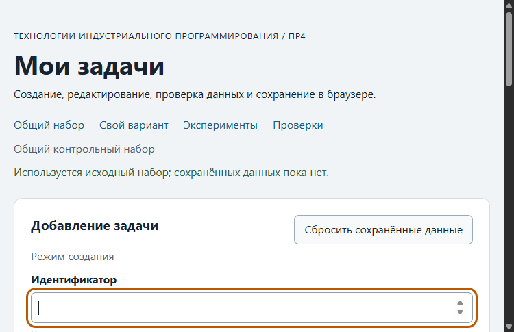

# Практическая работа № 4. Формы, валидация и локальное хранение данных

## Данные работы

| Поле | Значение |
|---|---|
| Имя | Сидорович Денис Сергеевич |
| Группа | ЭФБО-17-25 |
| Вариант из ПР2–ПР3 | № 7 («Подготовка учебного релиза», $N = 23$, формула: `((23 - 1) % 8) + 1 = 7`) |
| Node.js | v26.13.0 |
| Браузер | Microsoft Edge 141.0.3537.92 |
| Операционная система | Windows 11 (NT 10.0.26300.0) |

---

## Запуск

Рабочая папка: `practice-04` внутри личного репозитория `tip-js-practices`.

```bash
# Запуск модульных и сервисных тестов (35 сервисных + 27 модульных = 62 проверки)
npm test

# Запуск локального HTTP-сервера
npm start
# либо прямой запуск скрипта:
node tools/serve.mjs 5504
```

Доступные адреса при работающем сервере:
```text
http://127.0.0.1:5504/                          # Общий контрольный набор
http://127.0.0.1:5504/index.html?dataset=variant # Индивидуальный вариант 7
http://127.0.0.1:5504/examples/forms-storage.html # Лабораторные эксперименты с формами и JSON
http://127.0.0.1:5504/checks.html                # Браузерные автоматизированные проверки (23 сценария)
```

Остановка сервера: `Ctrl+C`.

---

## Перенос результата ПР3

Из предыдущего этапа ПР3 перенесены и интегрированы модули:

| Файл | Что перенесено или изменено |
|---|---|
| `data.js` | Перенесён без изменений: общий набор `demoTasks` (id `1, 4, 7, 10`) и вариант 7 `variantTasks` (id `11, 23, 37, 41, 58, 64`, $K = 6$, изначально все выполнены). |
| `task-service.js` | Перенесены 9 чистых функций ПР2/ПР3 (`createTask`, `findTaskById`, `getPendingTasks`, `getTaskTitles`, `getTaskStats`, `addTask`, `setTaskCompleted`, `renameTask`, `removeTask`) и добавлена новая функция `updateTask(tasks, id, title, priority)` с сохранением `id` и `completed`. |
| `task-selectors.js` | Перенесена чистая функция отбора по фильтру `getVisibleTasks(tasks, filter)` без мутаций. |
| `task-view.js` | Перенесена логика построения DOM (`createTaskElement`, `renderTaskList`, `renderSummary`, `renderEmptyState`). В карточку задачи добавлена обязательная третья кнопка `button[data-action="edit"]` со вложенной подписью `span.action-label` «Изменить». |

Результат повторной проверки перенесённого сервиса: успешно пройдены **все 35 проверок из 35** (`npm run check:service`).

---

## Эксперименты с формой и хранилищем

| № | До запуска: прогноз | После запуска: результат | Объяснение |
|---:|---|---|---|
| 1. Пустое обязательное поле | Браузер перехватит отправку до наступления события `submit`, покажет нативную подсказку валидации, `validity.valueMissing = true` | Событие `submit` заблокировано браузером, журнал остался пуст, фокус передан в поле `id`, отображено стандартное предупреждение браузера | Нативные ограничения HTML (`required`) проверяются браузером до генерации пользовательского события `submit`, предотвращая отправку неполных форм. |
| 2. Название из пробелов | HTML-ограничение `required` сочтёт строку из пробелов валидной; прикладная проверка через `trim()` обнаружит пустоту и заблокирует операцию через `setCustomValidity` | Форма попыталась отправиться, сработал прикладной обработчик: `trim().length === 0`, установлено пользовательское сообщение об ошибке, поле помечено невалидным | Атрибут `required` проверяет только факт наличия символов (включая пробельные). Для защиты модели требуется обязательная прикладная нормализация `trim()`. |
| 3. Типы значений `FormData` | `formData.get("id")` вернёт строковое значение `"20"` (тип `string`), а не число; `defaultPrevented` события равен `true` после вызова `event.preventDefault()` | `typeof rawId === "string"`, значение `"20"`; `defaultPrevented === true`, страница не перезагрузилась | Все элементы формы передают значения в `FormData` как строки. Преобразование в строгое число (`Number()`) должно выполняться явно на границе ввода. |
| 4. Строка в `localStorage` и JSON | `localStorage.getItem` вернёт сериализованную строку JSON; после `JSON.parse` восстановится JavaScript-объект | Строка `{"id":20,"title":"Изучить localStorage","priority":"high"}` прочитана и успешно разобрана в объект с сохранением свойств | Хранилище Web Storage оперирует исключительно строками. Для хранения структурированных данных необходимы `JSON.stringify` и `JSON.parse`. |
| 5. Повреждённый JSON | Вызов `JSON.parse` на некорректной строке выбросит `SyntaxError`; без блока `try/catch` выполнение скрипта аварийно прервётся | Перехвачено исключение `SyntaxError: Expected property name or '}'...`, возвращён fallback с исходным набором и предупреждением | Корректность синтаксиса JSON не гарантирована внешней средой; любые операции разбора сериализованных данных должны оборачиваться в `try/catch`. |

---

## Организация кода

- `src/data.js` — хранилище эталонных неизменяемых констант: общий набор `demoTasks`, индивидуальный набор Варианта 7 `variantTasks` и номер варианта `variantNumber = 7`.
- `src/task-service.js` — изолированная предметная бизнес-логика. Все 10 функций (`createTask`, `addTask`, `updateTask`, `removeTask`, `setTaskCompleted` и др.) являются чистыми, не обращаются к глобальным объектам `window`, `document` и `localStorage`.
- `src/form-validation.js` — модуль чистой прикладной валидации черновика `validateTaskDraft(draft, tasks, editingId)`. Нормализует поля, проверяет уникальность `id` при создании, проверяет существование задачи при редактировании, длину названия (1–100) и допустимость приоритета. Не взаимодействует с DOM.
- `src/task-storage.js` — слой взаимодействия с постоянным хранилищем. Функции `isValidTaskList`, `loadTasks`, `saveTasks`, `removeSavedTasks` принимают объект `storage` аргументом (Dependency Injection), что позволяет изолированно тестировать их на объектах-имитациях без глобального `localStorage`. Перед использованием данные из JSON валидируются функцией `isValidTaskList`, исключая использование повреждённых объектов.
- `src/task-view.js` — визуализация данных на основе DOM API (`createElement`, `textContent`, `replaceChildren`). Не содержит логики валидации или сохранения.
- `src/main.js` — координатор приложения. Хранит реактивное состояние (`currentTasks`, `currentFilter`, `editingId`), связывает события интерфейса с сервисом и хранилищем, переключает режимы формы и управляет доступностью фокуса.

---

## Проверка формы

| Сценарий | Ожидаемый результат | Фактический результат | Итог |
|---|---|---|---|
| Добавление корректной задачи (`id = 20`, название, `high`) | Задача добавлена в список, сохранена в storage, форма очищена | Карточка отобразилась, `currentTasks` содержит 5 элементов, данные сохранены в `localStorage` | Пройдено |
| Повторяющийся `id = 4` | Отказ без изменения списка, ошибка возле поля `id` | Поле `id` помечено `aria-invalid="true"`, выведено сообщение об ошибке, список не изменился | Пройдено |
| Пустое название | Отказ встроенной HTML-валидации | Браузер предотвратил отправку, отображено сообщение о необходимости заполнения | Пройдено |
| Название из пробелов | Отказ прикладной проверки | Выведено сообщение «Длина названия должна быть от 1 до 100 символов», форма не отправлена | Пройдено |
| Название длиной 100 символов | Успешное создание задачи | Задача успешно создана и отображена в списке | Пройдено |
| Название длиной 101 символ | Отказ прикладной проверки | Выведена ошибка длины, отправка отклонена | Пройдено |
| Редактирование title и priority (`id = 1`) | Изменяются название и приоритет, `completed: true` сохраняется | Название и приоритет обновлены, статус `Выполнена` сохранён | Пройдено |
| Отмена редактирования | Возврат к режиму создания, разблокировка `id`, очистка полей | Поле `id` разблокировано, кнопка «Добавить задачу», кнопка отмены скрыта | Пройдено |

---

## Общий сценарий

Проверка контрольной последовательности раздела 6.8 методички на общем наборе `demoTasks` (ключ `tip-js-practice-04:demo`):

| Шаг | Действие | Видимые id | Всего | Выполнено | Осталось | Прогресс | Состояние storage |
|---:|---|---|---:|---:|---:|---:|---|
| 0 | Исходный запуск после сброса | `[1, 4, 7, 10]` | 4 | 2 | 2 | `50.0%` | Ключ отсутствует (`null`) |
| 1 | Добавление `id = 20` (`Изучить localStorage`, `high`) | `[1, 4, 7, 10, 20]` | 5 | 2 | 3 | `40.0%` | Записана версия 1, 5 задач |
| 2 | Отказ для повторного `id = 4` | `[1, 4, 7, 10, 20]` | 5 | 2 | 3 | `40.0%` | Запись не производилась |
| 3 | Редактирование `id = 4` (`Подготовить форму задач`, `low`) | `[1, 4, 7, 10, 20]` | 5 | 2 | 3 | `40.0%` | Обновлено поле `title` и `priority`, статус `completed: false` сохранён |
| 4 | Переключение `id = 7` в выполненную | `[1, 4, 7, 10, 20]` | 5 | 3 | 2 | `60.0%` | Записана задача 7 с `completed: true` |
| 5 | Удаление `id = 1` | `[4, 7, 10, 20]` | 4 | 2 | 2 | `50.0%` | Задача 1 удалена из хранилища |
| 6 | Перезагрузка страницы | `[4, 7, 10, 20]` | 4 | 2 | 2 | `50.0%` | Данные восстановлены из `localStorage` |
| 7 | Сброс данных | `[1, 4, 7, 10]` | 4 | 2 | 2 | `50.0%` | Ключ удалён, восстановлен `demoTasks` |

---

## Проверка восстановления и ошибок

| Случай | Ожидание | Фактический результат | Итог |
|---|---|---|---|
| Записи нет | Используется независимая копия исходного набора | Отображён исходный набор, статус: «Используется исходный набор; сохранённых данных пока нет» | Пройдено |
| Корректная запись | Данные восстанавливаются после перезагрузки | Восстановлен полный список изменений, статус: «Данные восстановлены из localStorage» | Пройдено |
| Повреждённый JSON (`{broken-json`) | Приложение запускается с исходным набором и предупреждением | Исходный набор отображён, статус подсвечен предупреждением `is-warning` | Пройдено |
| Неверная версия или схема (`version = 999` или искажённые типы) | Исходный набор и предупреждение | Ошибочные данные проигнорированы, отображён fallback, статус сообщает об ошибке схемы | Пройдено |
| Сброс данных | Удаляется только ключ текущего набора | Ключ `tip-js-practice-04:demo` удалён, другие ключи origin сохранены | Пройдено |
| Общий и индивидуальный наборы | Изменения не смешиваются | Ключ `demo` и ключ `variant` изолированы, модификация одного не затрагивает другой | Пройдено |

---

## Индивидуальный вариант № 7

- **Студент:** Сидорович Денис Сергеевич
- **Тематика варианта:** «Подготовка учебного релиза»
- **Исходные задачи:** 6 задач с идентификаторами `[11, 23, 37, 41, 58, 64]`, изначально все выполнены ($K = 6$, прогресс $100.0\%$).
- **Действия по методичке варианта:**
  1. Добавление задачи `id = 75` с названием «Провести нагрузочное тестирование релиза» и приоритетом `medium` (изначально `completed: false`).
  2. Редактирование задачи `id = 23`: изменение названия на «Провести комплексное регрессионное тестирование» и приоритета на `high` (статус `completed: true` сохранён).
  3. Удаление задачи `id = 37` (была `completed: true`).
  4. Перезагрузка страницы для проверки сохранности.
  5. Проверка неизменности общего набора.
  6. Проверка сброса к исходным 6 задачам.

| Этап | Всего | Выполнено | Осталось | Прогресс | Видимые id |
|---|---:|---:|---:|---:|---|
| Исходный набор | 6 | 6 | 0 | `100.0%` | `[11, 23, 37, 41, 58, 64]` |
| После добавления `75` | 7 | 6 | 1 | `85.7%` | `[11, 23, 37, 41, 58, 64, 75]` |
| После редактирования `23` | 7 | 6 | 1 | `85.7%` | `[11, 23, 37, 41, 58, 64, 75]` |
| После удаления `37` | 6 | 5 | 1 | `83.3%` | `[11, 23, 41, 58, 64, 75]` |
| После перезагрузки | 6 | 5 | 1 | `83.3%` | `[11, 23, 41, 58, 64, 75]` |
| После сброса | 6 | 6 | 0 | `100.0%` | `[11, 23, 37, 41, 58, 64]` |

Итоговый прогресс $83.3\%$ (5 выполненных из 6 задач) строго соответствует контрольному значению методички для Варианта 7.

---

## Протокол проверок сервиса

Фактический вывод `node checks/service.checks.js`:

```text
OK: 01. Создание задачи с явным приоритетом
OK: 02. Приоритет по умолчанию
OK: 03. Удаление краевых пробелов без изменения внутренних
OK: 04. Граничные длины названия и положительный безопасный id
OK: 05. Некорректные названия при создании
OK: 06. Некорректные идентификаторы при создании
OK: 07. Все допустимые приоритеты и отклонение недопустимых
OK: 08. Каждый вызов createTask возвращает новый объект
OK: 09. Поиск по id, а не по индексу
OK: 10. Отсутствующая задача и пустой массив при поиске
OK: 11. Поиск не преобразует строковый id в число
OK: 12. Получение невыполненных задач
OK: 13. Пустой список, все выполнены и все не выполнены
OK: 14. Названия в исходном порядке и пустой список
OK: 15. Сводка по общему набору
OK: 16. Сводка по пустому списку
OK: 17. Сводка: ничего не выполнено и выполнено всё
OK: 18. Процент остаётся числом без предварительного округления
OK: 19. Добавление в конец без изменения входного массива
OK: 20. Добавление в пустой список с приоритетом по умолчанию
OK: 21. Повторяющийся id отклоняется
OK: 22. Добавление не обходит проверки createTask
OK: 23. Изменение completed в обе стороны
OK: 24. completed принимает только boolean
OK: 25. Некорректный или отсутствующий id при изменении статуса
OK: 26. Повторная установка статуса создаёт новый результат
OK: 27. Переименование сохраняет остальные поля
OK: 28. Проверки названия при переименовании
OK: 29. Некорректный или отсутствующий id при переименовании
OK: 30. Удаление по id с сохранением порядка
OK: 31. Удаление единственной записи
OK: 32. Некорректный, отсутствующий id и удаление из пустого списка
OK: 33. Входные объекты не изменяются ни одной операцией
OK: 34. Общий сценарий и все промежуточные сводки
OK: 35. Работа с другим набором, без зависимости от demoTasks

Проверок пройдено: 35; не пройдено: 0.
```

---

## Протокол проверок новых модулей

Фактический вывод `node checks/modules.checks.js`:

```text
OK: 01. updateTask изменяет название и приоритет выбранной задачи
OK: 02. updateTask нормализует название и сохраняет completed
OK: 03. updateTask не изменяет входной массив и объекты
OK: 04. updateTask отклоняет некорректный и отсутствующий id
OK: 05. updateTask отклоняет некорректные название и приоритет
OK: 06. Валидация создания нормализует поля
OK: 07. Валидация отклоняет некорректные id
OK: 08. Валидация отклоняет повторяющийся id при создании
OK: 09. Валидация проверяет название после trim
OK: 10. Валидация принимает только три приоритета
OK: 11. В режиме редактирования используется editingId
OK: 12. Редактирование отсутствующей задачи отклоняется
OK: 13. Валидация не изменяет draft и список
OK: 14. Проверка схемы принимает корректный список
OK: 15. Проверка схемы отклоняет неверную структуру
OK: 16. Отсутствующая запись возвращает независимую копию исходных данных
OK: 17. Корректная запись восстанавливается из хранилища
OK: 18. Повреждённый JSON приводит к безопасному fallback
OK: 19. Неизвестная версия приводит к безопасному fallback
OK: 20. Некорректные задачи из JSON не принимаются
OK: 21. Ошибка getItem перехватывается
OK: 22. Сохранение записывает версию и задачи
OK: 23. Некорректный список не записывается
OK: 24. Ошибка setItem перехватывается
OK: 25. Удаляется только переданный ключ
OK: 26. Ошибка removeItem перехватывается
OK: 27. Результат загрузки не разделяет объекты с fallback

Проверок пройдено: 27; не пройдено: 0.
```

---

## Протокол браузерных проверок

Фактический текст из блока «Текстовый протокол» со страницы `http://127.0.0.1:5504/checks.html`:

```text
OK: Фильтры ПР3 сохраняют порядок и не изменяют вход
OK: Карточка содержит toggle, edit и delete
OK: Название задачи выводится как текст
OK: Повторная отрисовка списка не накапливает карточки
OK: Сводка использует полный список и отдельный visibleCount
OK: Пустые состояния различают список и фильтр
OK: Приложение запускается с исходным набором
OK: Корректная форма добавляет задачу и сохраняет данные
OK: Повторяющийся id отклоняется без записи
OK: Название из пробелов отклоняется прикладной проверкой
OK: Нативные ограничения не пропускают пустую форму
OK: Кнопка edit заполняет форму и блокирует id
OK: Редактирование меняет title и priority, сохраняя completed
OK: Отмена редактирования возвращает режим создания
OK: Успешная отправка очищает ошибки и форму
OK: Изменение статуса сохраняется
OK: Удаление сохраняется
OK: Фильтр не записывается, но сохраняется после изменения данных
OK: Перезагрузка восстанавливает сохранённые задачи
OK: Сброс удаляет ключ и восстанавливает исходный набор
OK: Повреждённый JSON не ломает запуск
OK: Некорректная схема из storage заменяется исходным набором
OK: Общий и индивидуальный наборы используют разные ключи

Всего: 23. Пройдено: 23. Ошибок: 0.
```

---

## Собственные проверки

| № | Исходное состояние и действия | Ожидаемый результат | Фактический результат | Итог |
|---:|---|---|---|---|
| 1 | **Граница формы:** Ввод дробного идентификатора `id = "4.7"`, корректного названия и нажатие «Добавить задачу» | Прикладная валидация `validateTaskDraft` отклоняет значение `4.7` как нецелочисленное, поле `id` получает ошибку, в массив ничего не добавлено | Отказ валидации, `errors.id = "Идентификатор должен быть положительным целым числом"`, DOM и хранилище не изменены | Пройдено |
| 2 | **Восстановление после перезагрузки:** Последовательное добавление задачи `id = 99`, переключение её статуса в `completed: true` и имитация перезагрузки через `freshApp({ keepStorage: true })` | Приложение загружает сохранённый массив из `localStorage`, задача `99` присутствует с классом `.is-completed` и статусом «Выполнена» | Задача 99 отображена, класс `is-completed` присутствует, счётчик выполненных задач корректен | Пройдено |
| 3 | **Повреждённые данные storage:** Запись в ключ `tip-js-practice-04:demo` объекта с массивом задач, где у одной из задач дублируется `id`: `[{ id: 1, ... }, { id: 1, ... }]` | Функция `loadTasks` отклоняет данные из-за дублирования `id`, возвращает `source: "fallback"` с копией `demoTasks`, статус выводится с предупреждением | Приложение открылось с эталонными 4 задачами, в строке состояния отображено предупреждение о некорректной структуре | Пройдено |

---

## Отладка и клавиатура

### Точка останова в `handleFormSubmit`
Точка останова установлена на первой строке обработчика `handleFormSubmit` в `src/main.js`:
1. **Сырой черновик (`draft`):** `{ id: "20", title: "  Изучить localStorage  ", priority: "high" }`.
2. **Результат `validateTaskDraft`:** `{ ok: true, value: { id: 20, title: "Изучить localStorage", priority: "high" } }`. Идентификатор приведён к числу `20`, концевые пробелы названия удалены.
3. **Результат сервисной операции `addTask`:** `{ ok: true, tasks: [...] }` (новый массив из 5 элементов, ссылки на прежние 4 объекта неизменны).
4. **Строка JSON, отправленная в `setItem`:** `{"version":1,"tasks":[{"id":1,...},{"id":4,...},{"id":7,...},{"id":10,...},{"id":20,"title":"Изучить localStorage","completed":false,"priority":"high"}]}`.
5. **Ошибочный сценарий (повторный `id = 4`):** `validateTaskDraft` возвращает `{ ok: false, errors: { id: "Задача с таким идентификатором уже существует" } }`. Вызов `saveTasks` не производится, в поле `#task-id` установлен `aria-invalid="true"`.

### Проверка клавиатурного управления
- Клавиша **Tab** циклически перемещает фокус между полями ввода `task-id` → `task-title` → `task-priority` → кнопка «Добавить задачу» → фильтры → карточки задач (кнопки «Выполнена», «Изменить», «Удалить»).
- Нажатие **Enter** в поле названия инициирует событие `submit` формы.
- Нажатие **Space** активирует кнопки переключения статуса и фильтров.
- При клике на «Изменить» фокус автоматически переносится в поле `#task-title`, а поле `#task-id` блокируется (`disabled`). При нажатии на «Отменить» фокус возвращается в разблокированное поле `#task-id`.

---

## Вид приложения



---

## Дополнительное задание (Вариант Б: Межвкладочная синхронизация через событие `storage`)

Реализована поддержка межвкладочной синхронизации состояния через стандартное событие Web API `window.addEventListener("storage", ...)`:
1. При изменении данных, добавлении, редактировании, удалении или сбросе в одной вкладке браузера событие `storage` возникает во всех соседних открытых вкладках того же источника (`origin`).
2. Обработчик проверяет совпадение `event.key === storageKey`, считывает актуальные данные через безопасную функцию `loadTasks` и вызывает `renderApp()`.
3. Если во второй вкладке была открыта форма редактирования задачи, которая была удалена в первой вкладке, форма автоматически сбрасывается в режим создания `setFormMode(null)`.

Проверки:
- **Проверка 1:** Добавление задачи в первой вкладке мгновенно отображает её в списке второй вкладки без перезагрузки.
- **Проверка 2:** Нажатие «Сбросить данные» в первой вкладке возвращает вторую вкладку к исходному эталонному набору.
- **Проверка 3:** Ручное повреждение значения ключа в панели Application DevTools вызывает в открытой вкладке безопасный переход на `fallbackTasks` с выводом предупреждения без аварийной остановки приложения.

---

## Вывод

В ходе практической работы № 4:
1. Освоена работа с HTML-формами, событием `submit` и чтением параметров через `FormData`.
2. Реализовано строгое разделение уровней валидации:
   - **HTML Constraint Validation** (`required`, `min`, `maxlength`) обеспечивает базовый пользовательский контроль и стандартное клавиатурное поведение браузера.
   - **Прикладная валидация** (`form-validation.js`) проверяет модельную корректность: уникальность идентификатора, отсутствие чисто пробельных строк через `trim()`, допустимость приоритета.
   - **Слой персистентности** (`task-storage.js`) изолирует чтение и запись `localStorage`, сериализацию оболочки `{ version, tasks }`, валидацию структуры при чтении и обработку исключений без падения приложения.
3. Организована работа единой формы в двух режимах (создание и редактирование) с блокировкой первичного ключа и сохранением признака выполнения `completed`.
4. Реализовано дополнительное задание по межвкладочной синхронизации на базе события `storage`.
5. Все 35 тестов сервиса, 27 тестов новых модулей и 23 браузерных сценария успешно пройдены.
